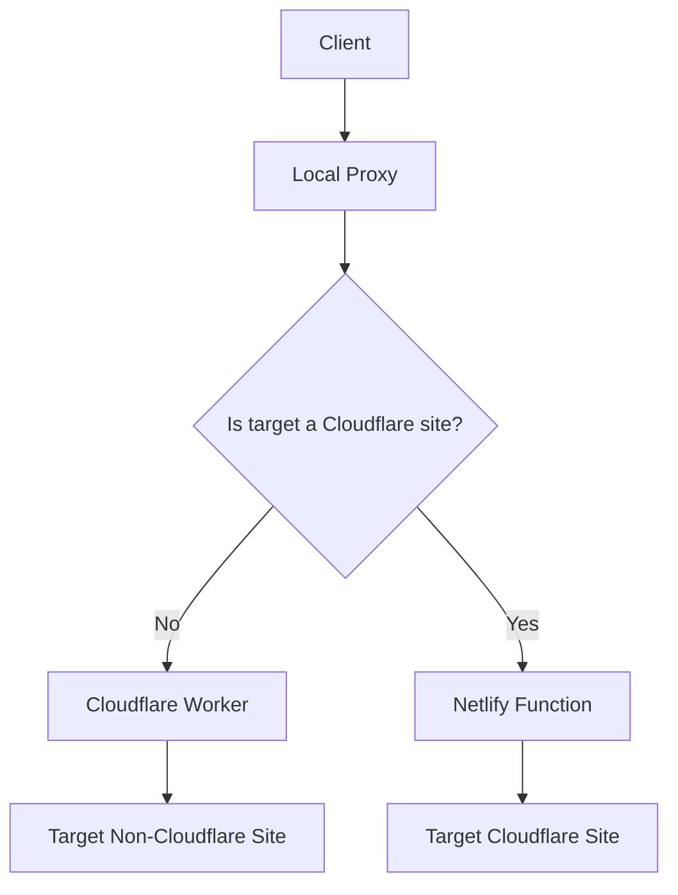

# Solution Plan: Bypassing Cloudflare-to-Cloudflare Limitation

## Problem Statement
The current warpify implementation has a limitation where Cloudflare Workers cannot connect to other Cloudflare-protected services directly. This is because Cloudflare blocks connections to its own IP address space from within Workers.

## Proposed Solution
We will implement a two-part solution:
1. Use NAT64 to translate IPv6 addresses to IPv4 for Cloudflare-protected sites
2. Create a Netlify function as an HTTPS tunnel for sites that cannot be reached via NAT64

## Architecture Overview



## Implementation Details

### 1. Cloudflare Site Detection
We need to create a mechanism to detect if a target site is protected by Cloudflare:
- Create a new module `src/cloudflare-detector.js`
- Implement a function to check if a domain is behind Cloudflare
- This can be done by checking for Cloudflare-specific headers or DNS records
- Cache results to avoid repeated lookups

### 2. NAT64 Implementation
Cloudflare provides NAT64/DNS64 services that can translate IPv6 addresses to IPv4. We can leverage this by:
- Detecting if a target is a Cloudflare-protected site
- Using IPv6 addresses for these targets to leverage NAT64 translation
- Modifying the target resolution in the proxy connector

### 3. Netlify Function as HTTPS Tunnel
For cases where NAT64 doesn't work or isn't suitable, we'll create a Netlify function that:

#### Function Requirements:
- Accepts HTTPS requests with target information and headers
- Makes the actual HTTP request to the Cloudflare-protected site
- Returns the response to the Cloudflare Worker
- Implements authentication to prevent abuse
- Handles various HTTP methods (GET, POST, etc.)
- Supports streaming for large responses

#### Function Interface:
- Endpoint: `/tunnel`
- Method: POST
- Headers:
  - `Authorization`: Token for authentication
  - `X-Target-URL`: The target URL to proxy
  - `X-Target-Method`: HTTP method (GET, POST, etc.)
  - All other headers should be forwarded to the target
- Body: Request body to send to the target (for POST, PUT, etc.)

#### Response Format:
- Status code matching the target response
- Headers from the target response
- Body from the target response

### 4. Cloudflare Worker Modifications
The Cloudflare Worker will need to be modified to:

#### Current Implementation:
- Receives WebSocket connections with `X-Proxy-Target` header
- Connects directly to the target using `connect()`

#### Modified Implementation:
- Check if the target is a Cloudflare-protected site
- If it is, route through the Netlify tunnel instead of direct connection
- If it's not, use the existing direct connection approach
- For Netlify tunnel routing:
  - Make an HTTPS request to the Netlify function
  - Forward the response back through the WebSocket

### 5. Proxy Connector Updates
The proxy connector will need to:

#### Current Implementation:
- Creates WebSocket connection to Cloudflare Worker
- Sends data through the WebSocket
- Receives data from the WebSocket

#### Modified Implementation:
- Detect Cloudflare-protected sites before creating WebSocket connection
- For Cloudflare sites, route through a different path (Netlify tunnel)
- Implement a new connection method for Netlify tunnel
- Maintain existing functionality for non-Cloudflare sites

## File Structure
```
project/
├── worker/
│   └── src/
│       └── index.js          # Modified Cloudflare Worker
├── netlify/
│   └── functions/
│       └── tunnel.js         # Netlify function for HTTPS tunnel (to be implemented in code mode)
├── src/
│   ├── proxy-connector.js    # Updated proxy connector
│   ├── cloudflare-detector.js # New module to detect Cloudflare sites
│   └── server.js             # Potentially updated for Cloudflare detection
└── config.example.json       # Updated configuration example
```

## Implementation Steps
1. Create Cloudflare site detection mechanism
2. Update configuration to include Netlify tunnel settings
3. Modify Cloudflare Worker to route Cloudflare targets through Netlify tunnel
4. Update proxy connector to detect Cloudflare sites and use appropriate routing
5. Implement Netlify function for HTTPS tunneling (in code mode)
6. Test with various Cloudflare-protected sites
7. Document the solution and deployment process

## Configuration Changes
We'll need to add new configuration options to `config.example.json`:
- `netlify_tunnel_url`: URL of the Netlify function
- `netlify_tunnel_token`: Authentication token for the Netlify function
- `cloudflare_detection_enabled`: Boolean to enable/disable Cloudflare detection

Example configuration:
```json
{
  "worker": [
    "your-worker-1.workers.dev",
    "your-worker-2.workers.dev"
  ],
  "authorization": "your-auth-token",
  "port": 1080,
  "type": "socks",
  "verbose": false,
  "retry_enabled": true,
  "max_retries": 5,
  "retry_initial_backoff": 100,
  "retry_factor": 2,
  "load_balancing_strategy": "random",
  "netlify_tunnel_url": "https://your-netlify-function.netlify.app/.netlify/functions/tunnel",
  "netlify_tunnel_token": "your-netlify-token",
  "cloudflare_detection_enabled": true
}
```

## Security Considerations
- The Netlify function must implement proper authentication
- Rate limiting should be considered to prevent abuse
- The function should validate target URLs to prevent internal network access
- HTTPS should be enforced for all communications
- The Cloudflare detection mechanism should be cached to prevent abuse

## Detailed Implementation Plan

### Step 1: Cloudflare Detection Module
Create `src/cloudflare-detector.js` with:
- Function to check if domain is Cloudflare-protected
- Caching mechanism for results
- Configuration options

### Step 2: Configuration Updates
Update configuration parsing in `src/config.js` to handle new options

### Step 3: Cloudflare Worker Modification
Update `worker/src/index.js` to:
- Check if target is Cloudflare-protected
- If so, make HTTPS request to Netlify function instead of direct connection
- Forward response back through WebSocket

### Step 4: Proxy Connector Updates
Update `src/proxy-connector.js` to:
- Import Cloudflare detection module
- Check target before creating WebSocket connection
- For Cloudflare targets, use HTTP connection to Netlify tunnel
- Maintain existing WebSocket functionality for non-Cloudflare targets

### Step 5: Server Updates (if needed)
Potentially update `src/server.js` to:
- Pass Cloudflare detection settings to proxy connector