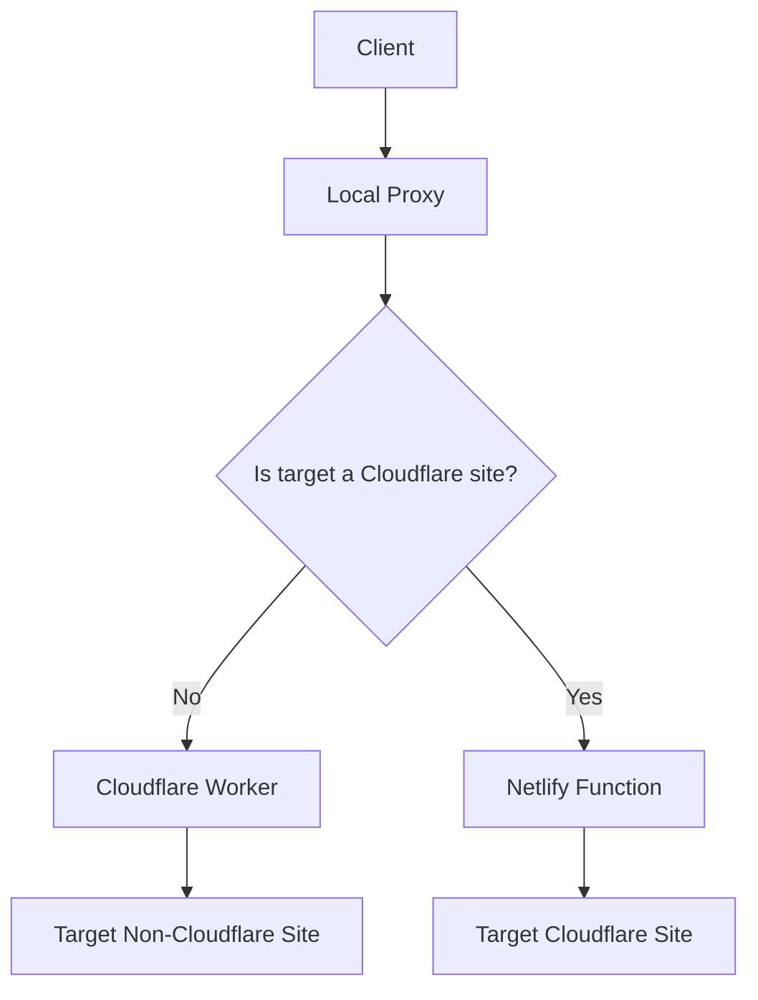

# Solution Summary: Bypassing Cloudflare-to-Cloudflare Limitation

## Overview
This solution addresses the limitation in warpify where Cloudflare Workers cannot connect to other Cloudflare-protected services directly. The implementation provides two approaches:
1. NAT64 translation for IPv6-to-IPv4 connectivity
2. A Netlify function acting as an HTTPS tunnel for sites that cannot be reached via NAT64

## Created Documentation Files

### 1. Solution Plan
**File**: `solution-plan.md`
**Purpose**: Comprehensive overview of the problem and proposed solution
**Contents**:
- Problem statement and limitations
- Proposed architecture with Mermaid diagram
- Detailed implementation approach
- File structure changes
- Configuration updates
- Security considerations

### 2. Cloudflare Detector Design
**File**: `cloudflare-detector-design.md`
**Purpose**: Design specification for detecting Cloudflare-protected sites
**Contents**:
- Detection methods (DNS, HTTP headers, WHOIS)
- Module interface specification
- Caching strategy
- Configuration options
- Error handling approach

### 3. Netlify Tunnel Design
**File**: `netlify-tunnel-design.md`
**Purpose**: Design specification for the Netlify HTTPS tunnel function
**Contents**:
- Function interface (request/response format)
- Authentication mechanism
- Request validation and security measures
- SSRF protection implementation
- Error handling strategies

### 4. Proxy Connector Update Plan
**File**: `proxy-connector-update-plan.md`
**Purpose**: Detailed plan for modifying the proxy connector
**Contents**:
- Current implementation overview
- Required changes for Cloudflare detection
- New connection methods
- Backward compatibility considerations
- Testing requirements

### 5. Testing Plan
**File**: `testing-plan.md`
**Purpose**: Comprehensive testing approach
**Contents**:
- Test environments
- Test cases for different scenarios
- Target sites for testing
- Testing methodology
- Success criteria and performance metrics

### 6. Deployment Guide
**File**: `deployment-guide.md`
**Purpose**: Instructions for deploying the enhanced solution
**Contents**:
- Prerequisites and setup steps
- Configuration options
- Environment variables
- Testing procedures
- Troubleshooting guide
- Security considerations

## Implementation Approach
The solution is designed to be implemented in the following order:
1. Create the Cloudflare detection module
2. Update configuration parsing to support new options
3. Modify the Cloudflare Worker to route Cloudflare targets through the Netlify tunnel
4. Update the proxy connector to detect Cloudflare sites and use appropriate routing
5. Implement the Netlify tunnel function
6. Test the complete solution
7. Document the implementation and deployment process

## Key Features
- **Backward Compatibility**: Existing configurations continue to work without changes
- **Flexible Routing**: Automatic detection and routing based on target site
- **Security**: Multiple layers of protection including authentication, SSRF prevention, and rate limiting
- **Performance**: Caching and efficient connection handling
- **Monitoring**: Comprehensive logging and error handling

## Architecture Diagram
The solution follows this architecture:

## Next Steps
To implement this solution, switch to code mode to begin creating the actual implementation files based on these designs.